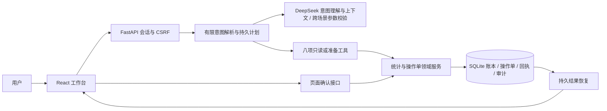
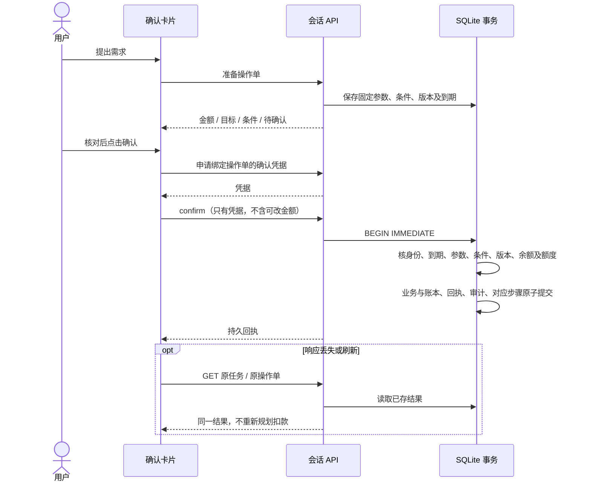
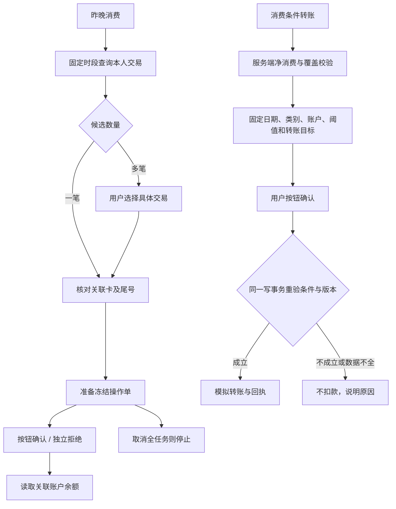

# 实际架构与确认时序

截至 2026-09-26 对话体验改进；图中各项对应当前代码。所有银行业务只使用本地合成数据。

模型作用：live 单场景由 language.py 接收最近 16 条当前会话消息及待确认模拟操作摘要，理解意图、口语金额和补充信息；支持能力介绍、引导追问与一般预算交流。账户与收款人仅在本地解析，同名对象仍追问。账户目录、原始流水、会话令牌和密钥不加入模型上下文。金额计算、权限、条件和最终提交均由服务端完成；明确数额的预算示意也由程序计算。两条跨场景仍使用固定计划与原有参数校验。mock 使用本地规则与相同业务服务；两种模式始终可见，不静默降级。

计划最多 12 步、1 个写操作；部分拒绝仍可执行独立余额读取。冻结成功后余额读取失败，保留成功回执，只重试余额。并发与故障边界见 `backend/tests/test_m3.py`、`test_m5.py` 和 M6 浏览器验收。

## 当前限制

2026-09-27 修复：`data/atomic.py` 提供可组合 SQLite 写事务；单场景 live 的模型调用前保存请求版本，返回后在写锁内重新加载任务并核对版本/终态/停止标志，校验与结果持久化共享事务。显式过期 ORM 缓存，兼容生产 `expire_on_commit=False`。跨场景条件修订和普通转账转换由服务端解析；支持严格大于/小于，未知条件停止旧单并追问。流水步骤新增 `arguments`，`TransactionEvidence` 用原查询条件展示与翻页。无需数据库结构迁移。

- 仅支持人民币、预置账户/收款人、既有模板与两条跨场景故事；没有真实身份认证、真实支付、理财推荐、订阅扣费、持续监控或任意自然语言规划。
- SQLite 适合本地单实例演示；生产部署、多租户身份、隐私处理、风控及运维没有验收。
- 模型只有一次临时故障重试；结构或引用无效时追问/失败。M7 历史分数基于旧的指定工具适配器，不能作为当前自然语言理解准确率。新版证据见 ACCEPTANCE/CONVERSATION-2026-09-26.md。
- 自动化流程耗时不包含人类阅读与思考；没有外部用户研究和可量化的人类效率结论。
