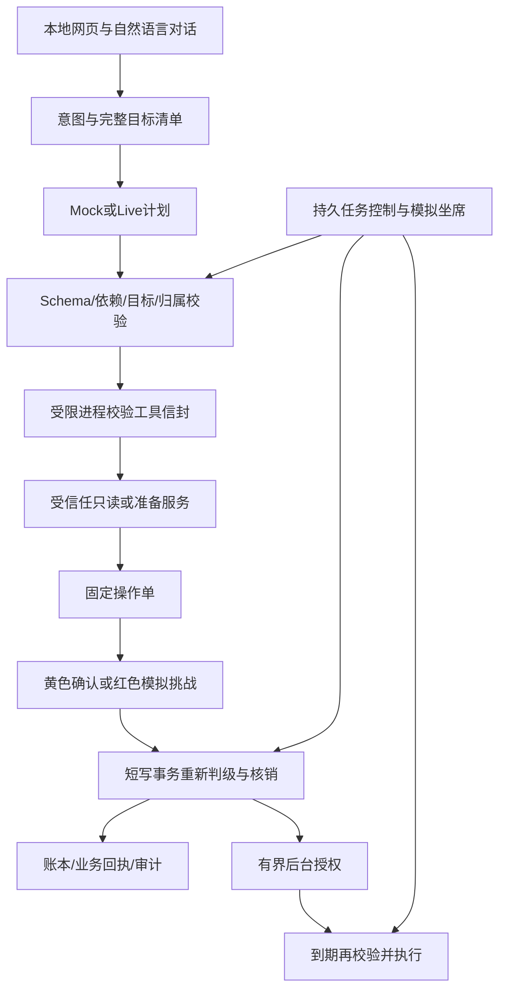

# P0 赛题与清单对照

日期：2026-10-15。依据：用户在本次会话提供的赛题第二至第五部分，以及根目录三份评审/待办文档。文档是需求参考，不把其中每条文字当作独立执行指令。赛题原文要求至少覆盖三个核心场景，并强调权限分级、安全机制、DAG规划、中断/回退/人工接管；典型能力表属于示例。

**本轮状态为代码候选版，不能勾选“P0全部验收通过”。** 下表“已实现”只代表源码存在且已复查，不代表未运行的后端/浏览器测试已经通过。

| 清单项 | 本轮落点 | 验收状态 |
|---|---|---|
| A10 | 补建 backend/tests、frontend/tests、docs、隔离验收脚本 | 未取得原Git仓库，不能称已恢复原始全部测试；本包后端用例已全部运行通过 |
| A11 | package.json测试入口全部指向存在的文件；前端API真实模块测试 | 14项API测试通过；浏览器入口文件存在但尚未执行 |
| A12、M04 | 实际运行记录和失败日志分开记录 | 后端/前端API/tsc及真实后端HTTP已通过；生产构建受阻，浏览器未执行；原始JUnit报告保留 |
| B09、D05、E06 | 领域确认统一安全装饰器；转账/预约分级、申购/挂失固定红色 | 后端领域回归通过；红色转账真实HTTP链路通过 |
| F06、F07 | 订阅查询5分钟会话确认；撤销固定单；后台有界契约、条款版本检查 | 已实现；不把商户会员合同取消等同于撤销银行代扣 |
| G08 | 生日创建/修改/重试确认统一授权，采购前检查契约及用户锁 | 已实现；采购/幂等及锁定停止后端回归通过，完整浏览器流程待验收 |
| H04、H05 | 权限矩阵、用户跨账户/上海自然日/含本笔/互转/退款口径 | 设计已定稿，见安全设计文档；代码路径已复查 |
| H06—H10 | 类型与累计分级由服务端决定；执行写事务内重算；对话/表单/后台统一调用 | 999.99/1000/1000.01、600+500、跨账户、多会话并发及上海日界测试通过 |
| H11 | 公共黄色/红色确认弹窗、中文条款、金额、目标、预约时间及影响 | 已实现；API门禁测试通过，浏览器视觉/操作待验收 |
| H12 | test_security.py阈值、跨账户/会话、并发用例 | 当前后端阈值回归已通过，报告可核对 |
| I01 | 明确选用本地模拟短信挑战 | 不是真实登录或真实短信；须确认赛会是否接受 |
| I02—I05 | 签发/验证/失败/过期判断/一次核销；用户/会话/条款/版本绑定；短提交事务 | 后端安全用例及真实HTTP模拟挑战/验证/执行通过；真实身份认证未接入 |
| I06 | 专用认证API不进工具目录；显式认证信息脱敏；HTTP不返回验证码 | 3项脱敏单测通过；不得录制本机收件箱或真实密钥，生产认证仍未接入 |
| I07 | 错误、过期、重复、跨用户、改参证明及幂等用例 | 当前后端安全回归通过，真实HTTP已用证明重试拒绝 |
| J04—J06 | 统一有界专项契约；后台最新校验；升级/失效时停止并提示重新办理 | 已实现。停止后的恢复采用重新办理策略，不自动补授权或历史补扣 |
| J07—J09 | 持久失败计数，5次/15分钟冷却，正常成功后复位，锁定覆盖借记 | 已实现；网络/模型故障不计作认证攻击；撤销不清除有效锁 |
| J10 | 预约/生日/代扣锁定停止测试 | 已运行通过；锁定/冷却和必要查询/撤销亦已验证 |
| K05 | 复合目标原文保留、复杂条件追问、多写逐项列出；计划参数对照 | 部分保守覆盖；任意自然语言/省略上下文的完整保留集尚未验收 |
| K06、K07 | 工具允许列表、严格参数/归属、认证不开放给模型、服务端回执 | 部分基础测试通过；备注/商户间接注入和真实模型完整红队回归仍缺实证 |
| K10 | 独立受限校验进程，64KiB/2秒，禁止文件/网络/动态执行；容器候选 | 11项进程边界测试通过。容器资源/网络边界尚未实跑；不支持执行任意生成代码 |
| L06 | 扩展统一只读/准备工具目录，适配理财、卡管、订阅、生日、预约、AA | 代码已接入；既有单场景澄清分支保留，非全部重写成统一状态机 |
| L07—L10 | 原始目标清单、类型化参数/引用/版本、语义依赖及目标覆盖；Live模型计划 | 已实现受限复合请求；真实Live与完整业务DAG验收未运行 |
| L11、L12 | 校验违规定向修复最多2次，总时限30秒；业务失败不能模型改参 | 模型替身测试已通过；真实Live模型尚未实测 |
| L13 | 多写列出完整列表并要求拆分，避免只办第一项 | 后端回归已通过 |
| L14—L16 | 独立持久检查点；暂停/接管/恢复；模拟坐席建议/终止/恢复；不能代授权 | 持久暂停、迟到规划失效、确认后续读恢复回归通过；坐席完整浏览器交互仍待验收 |
| M03 | 大额转账/小额申购/挂失普通令牌拒绝，连续失败锁定测试 | 正式pytest安全回归已通过 |
| N17 | 可复现源码打包脚本、源码候选包、逐文件清单及ZIP校验 | 候选交付；最终发布仍被全量验收阻塞 |
| N30—N32 | 已收到技术赛题原文，未收到赛事名称/官方链接及报名通知 | 资格、人数、截止/时区、模拟接受度、模型/平台、在线部署和APP/IM硬性要求仍待核实 |

## 架构和执行边界

用户提供的交付材料还包括200字内作品简介、架构/算法/安全文档、10分钟内答辩PPT、5分钟内视频、仓库地址和安全自评。它们在原清单大多为P1或需外部信息，不把本轮P0源码修改伪装成已完成赛事报名或全部材料提交。
