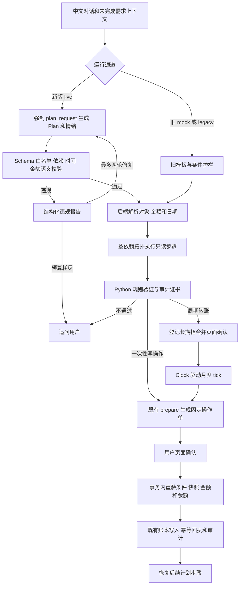

# R10 最新修订（2026年10月14日）

周期追问与默认日期已迁入后端 R10。当前全量后端回归193项通过，真实模型调用0；下文180和164项为历史版本记录。细节见 temporal-r10.md（输出目录为 R10_周期规则修订说明.md）。

# 2026年10月14日后续修订

当前代码的最新全量结果为180项全部通过。后续修复了Windows PowerShell启动脚本编码、Vite代理Host、模型HTTP异常分流及DeepSeek strict Schema兼容问题，并增加正常信息澄清资产。下文164项是首版交付时的历史检查记录。

正常追问允许steps为空且clarification非空，这类资产不执行工具；可执行计划仍要求1至12步。模型HTTP错误现在出现在Trace.model_error，不再误报为两轮计划修复失败。具体重启和400定位方法见HTTP400修复与排查说明。

# FinAgent 新版神经符号架构技术报告

交付日期 2026年10月14日

新版代码已实现在 D 盘原项目 `D:\finagent` 中。它将语言理解、计划校验、业务规则和执行授权分开：模型生成可保存的 Plan 资产，后端负责对象解析、精确金额、时间解释和业务验证，最后由用户在页面确认固定操作单。旧 mock 与旧 live 通道仍可切换，用于回归、降级和后续对照。

本次完成提示词的任务一至任务七，并实现任务八的 observe 统计脚本。最终工程检查为 **164项后端测试全部通过，其中原有113项、新增51项**；前端 TypeScript 检查和 Vite 生产构建通过。检查采用合成数据、隔离 SQLite 和模型替身，真实模型调用为0。没有实施真实 DeepSeek 效果评测、基线对照、消融、压力或收益实验，因此本报告不宣称新版在准确率、延迟或风险指标上已优于论文或旧版。

## 1 交付范围与架构取舍

比赛截图要求 AI Banking Agent 至少覆盖三个核心场景。当前项目可演示智能转账、账单与消费分析、卡片管理三类能力。新版增强的是这些场景的计划表达、条件保留、多任务执行、周期转账与可审计性；它没有实现理财产品推荐、AA拆分、订阅代扣，也没有接入真实银行。

随附 VA-NSF 中文译文提供了类型化 AST、验证证书、结构化违规反馈和定向修复的分层思路。项目按改造提示词使用 JSON Schema 与强制工具调用，验证器使用普通 Python 规则注册表，继续复用 DeepSeek 通道。没有引入 ASP、Clingo、PDDL、LoRA 或 tokenizer 级语法约束。

证书记录的是指定版本的已编码规则在该次检查中通过，不是法律合规证明或对全部自然语言语义的形式化证明。JSON Schema 能约束结构，仍需语义校验与真实模型实验；本次也没有证明其效果与论文的 FSM 解码完全等价。

## 2 完整工作流程



用户身份始终来自演示会话与服务端数据库，不接受模型提供 owner_id。模型仅输出名称、尾号和用户表达的元金额字符串；后端匹配归属资源并用 Decimal 转为整数分。`prepare_` 只创建操作单，聊天里的“确认”不会执行业务。真正扣款和卡状态变更仍位于原有确认事务中。

一次请求可保存最多12个步骤。新版允许多个写步骤，但每次只准备一张待确认操作单。确认后继续剩余步骤，并为下一笔写操作生成新的操作单；每笔分别确认，避免把多笔计划整体当作一次授权。

## 3 模块与代码组织

| 模块 | 职责 |
|---|---|
| `backend/app/clock.py` | RealClock、ManualClock、全局时钟和业务日期 |
| `backend/app/agent/guardrails.py` | 条件标记唯一词表、极值词、中文金额归一化 |
| `backend/app/planning/schema.py` | Plan 类型、Schema、拓扑排序、依赖与时间结构校验 |
| `backend/app/planning/provider.py` | DeepSeek 强制 plan_request、反馈与两轮修复预算 |
| `backend/app/planning/engine.py` | 对象与金额落地、语义检查、持久化步骤、逐笔确认与恢复 |
| `backend/app/verifier/__init__.py` | 规则注册表、VerifyResult、证书、违规与 observe 审计 |
| `backend/app/standing.py` | 周期指令确认、月度调度、管理、到期操作单领取 |
| `backend/app/tracing.py` | 对话请求的结构化持久化 Trace |
| `backend/app/neuro_models.py` | 五张独立新增表 |
| `backend/app/neuro_api.py` | 日历、Trace、验证记录与周期管理 API |
| `backend/app/run.py` | 新版启动参数 |
| `frontend/src/NeuroPanel.tsx` | 最简日历、长期指令确认、通知与 Trace 查看 |
| `scripts/observe-report.py` | 只读统计 observe 命中记录 |

旧 `agent/service.py`、`agent/crossflow.py` 和 `domain/operations.py` 仅作护栏、时钟、验证钩子与任务接线等必要修改。原有账本函数、确认令牌校验、参数摘要、快照逻辑、幂等回执和事务边界继续复用。

## 4 Plan 资产及神经符号边界

Plan 包含 `steps`、可选 `recurrence`、`emotion` 和 `clarification`。每一步有 `id`、`tool`、`params`、`depends_on`、可选 `condition` 与 `recurrence`、以及 `on_failure`。代码同时输出 `planning/plan.schema.json`，实际 live 请求会将 Schema 转成 strict 工具调用所需的对象结构。

```json
{
  "steps": [
    {"id": "read", "tool": "list_accounts", "params": {}, "depends_on": []},
    {
      "id": "write",
      "tool": "prepare_transfer",
      "params": {"source": "活期账户", "target": "储蓄账户", "amount_yuan": "100"},
      "depends_on": ["read"]
    }
  ]
}
```

以上是便于阅读的省略默认字段示例。真实 strict 请求要求模型按 Schema 填写各字段，缺失的可选业务信息可用 null；服务端 Pydantic 模型仍负责再次校验。

工具白名单沿用既有 registry 和 `validate_plan`。新版主要计划工具为账户、收款人、卡片、流水与消费查询，以及转账和卡片操作准备。已有 `get_task_status` 也已接入新版 Plan，其 task_id 必须属于当前会话和数据版本的已有操作任务；服务端向模型提供归属任务目录，模型不能猜测或读取其他用户任务。

校验会拒绝重复步骤ID、未知依赖、循环依赖、未知工具、工具能力之外的参数，以及没有前置读依赖链的写步骤。消费条件必须引用前置 `summarize_spending` 步骤，不能引用任意模型文本。

模型输出的金额除了类型检查，还需对应用户的转账子句，避免把“餐饮超过500元，转100元”误写成转500元。对象必须在未完成需求的用户表达中有依据，同名对象由后端追问。历史中已完成的写指令不会作为新请求的授权来源。

时间仅通过结构化表达式进入新 Plan。支持 `period` 的本月、上月、今天、昨天，`offset` 的日或月偏移，以及 `recurring` 的每月指定日。由后端 Clock 计算实际日期；模型不能输出 `start=2026-...` 这样的绝对日期字段。用户明确说“上月”而模型省略时间，也会触发语义违规。

消费比较本期限定为严格大于或小于。至少、不超过、以上、以下、否则分支等无法完整表示时追问，不静默换成严格比较。去年、上周、昨晚等尚未进入新 Plan 时间结构的表达也会明确澄清；旧版已有的昨晚交易调查流程仍保留在 legacy 通道。周期转账与消费条件的组合目前会明确拒绝并要求拆分，不会省略其中任一部分。

## 5 定向修复与降级

初次生成失败后，后端把 `rule_id`、字段、观测值、期望值与中文提示，以及前一份候选 Plan 拼入下一次请求。最多允许两轮修复，即初次生成加两次重试，最多3次生成调用。预算用尽后转为用户追问，不继续循环。

Schema/语义错误与网络失败分开处理。连续非法 Plan 会进入澄清。模型服务不可用时，对完整识别的既有场景可回退模板并明确说明；复杂要求不能可靠覆盖时停止并追问。回退不会获得执行或确认工具，也不会自动扣款。

本次正常 Plan 使用模型替身验证了两步依赖和执行链；非法 Plan 重放使用了3次替身生成、记录2轮修复并最终拒绝。真实 DeepSeek 工具调用兼容性、表达覆盖率和修复有效性尚未通过真实服务实验验证。

## 6 规则验证器与证书

统一接口为 `verify(action, params, context) -> VerifyResult`。结果包含 `approved`、`certificate`、结构化 `violations` 和 `would_block`。context 预留 emotion；本期没有情绪风控策略。

| 规则 | 模式 | 行为 |
|---|---|---|
| R1 条件完整性 | enforce | 有条件语言而写操作没有完整条件时拒绝 |
| R2 余额充足 | enforce | 后端归属账户余额不足时拒绝 |
| R3 资源快照一致 | enforce | 复用既有快照检查，状态或版本改变时拒绝 |
| R4 周期落地目的地 | observe | 周期指令误指向普通一次性操作时记录 would_block |

注册新业务规则默认采用 observe，只有显式指定 enforce 才拦截。Plan 的结构和能力限制属于资产校验，不等同于新增业务风控规则。R4 即使处于 observe，周期执行器也只会把周期资产送往长期指令登记流程。

通过证书含 `ruleset_version`、通过规则列表、Clock 时间戳、action digest 与规则模式。证书和违规明细保存在 `verification_records`，既有 `audit_events.detail_code` 引用记录ID；这样不用给旧审计表添加字段。可通过验证记录查询接口读取。

验证钩子覆盖准备阶段、准备完成后的快照证书以及确认事务内部。确认时仍会重新计算已有消费条件，验证参数摘要、资源版本、余额和原有额度，随后才调用账本函数。保留原余额不足 HTTP 400 语义；快照变化仍使用既有 STALE_RESOURCE 错误语义。

## 7 时钟和手动日历

`--clock manual` 默认用于演示，启动时从 `demo_settings.demo_date` 取初始营业日期。`--clock real` 使用真实时间。业务日期由 UTC 时钟转换为 Asia/Shanghai 日期。

条件区间、统计默认范围、操作单与令牌过期、日额度计算、账本与审计时间戳、周期触发均已接到 Clock。旧 `domain/clock.py` 保留日期范围函数与兼容接口，但其系统时间委托新时钟。演示数据本身不会随着拨日历自动扩充或改写。

`GET /api/debug/clock` 和 `POST /api/debug/clock/advance {"days":N}` 只供本机 manual 模式使用，real 模式返回403。推进日期会延长发起调试的 UI 会话租期，使当前页面可以继续查看结果；不会延长业务操作单的5分钟有效期。其他过期会话需重新选择演示用户。

工程重放的实际结果：

| 查询 | 日期区间 | 已知净消费 | 数据完整性 |
|---|---|---|---|
| advance 前的本月餐饮 | 2026-09-01 至 2026-09-24 | 1200.00元 | 完整 |
| advance 32天后同一查询 | 2026-10-01 至 2026-10-26 | 0.00元 | 不完整 |

第二行不能解释为用户10月真实没有消费。旧种子只提供已覆盖的数据，正确结论是新月份已知消费为0但证据不完整。另一个操作单在 Clock 推进301秒后显示 expired，证明过期判定也随手动时钟走。

检索发现剩余 `datetime.now()` 仅位于 RealClock 自身和旧 `agent/evaluate.py` 的评测会话/报告时间与文件名。评测脚本本次未运行，保留其旧行为；若未来让旧评测器直接比较 manual 与 real，需先统一其会话时间来源。

ManualClock 是进程内单例。手动模式必须单 worker，重启会重新从 demo_date 初始化；它不是跨进程、可持久化的生产调度时钟。

## 8 周期转账与多阶段确认

长期指令解析完成后先登记草稿，再在页面显示来源、目标尾号、固定金额、每月日期与持续有效说明。用户确认后才进入 active。未指定月内日期时，先问“每月转账需要固定日期，设置为每月1号可以吗？”，明确同意后才填1号。

`standing_orders` 保存 owner、结构化参数与 schedule、intent_hash、数据版本及状态。除 active、paused、cancelled 外，额外使用 pending_confirmation 表示尚未授权的草稿。长期确认请求保存在独立的 `standing_confirmations`，有会话归属、5分钟时限、一次性令牌和哈希检查。

`tick()` 计算每个已生效指令自激活以来的到期月份。`standing_occurrences` 的 `(order_id, period)` 唯一约束防止同月重复。每次只调用既有 `prepare_transfer`，生成普通待确认操作单。余额不足会保存 skipped 与中文原因通知；已有活动写任务时暂缓并在后续 tick 重试。

手动日历跨过触发日仍会发现到期月份，而不会静默丢掉该月。多个月同时到期时，既有一张活动操作单限制会串行化待处理月份。每张操作单均需页面确认，没有批量自动扣款。

月末规则固定为 `min(day, 当月天数)`。31日指令在2027年2月落到2月28日，在2028年2月落到2月29日；不延到下个月1日。

real 模式的后台循环每30秒 tick。用户会话过期时，可为已被页面授权的指令创建服务端调度会话，只准备操作单。用户重新登录后，通过“查看并核对本期操作单”领取：原未执行单作废，按同一锁定参数重新准备，并走正常页面确认和事务重验。已执行的月份不能再生成，取消长期指令也会使其尚未执行的本期操作单失效。

支持通过页面、API或中文对话查询、暂停、恢复和准备取消定期转账；多个指令需指定编号。取消需要页面确认，聊天本身不完成取消。暂停或取消不会撤销已执行的交易。

## 9 数据库与信任边界

新增表为 `verification_records`、`neuro_traces`、`standing_orders`、`standing_confirmations`、`standing_occurrences`。没有 ALTER 旧表、没有运行主库迁移、没有重置主库或修改历史种子数据。新表在服务启动时以 `checkfirst` 创建。

验收全部使用 `D:\finagent\var\neuro-validation` 下的临时库。最终只读检查主库时，五张新增表尚不存在，说明此次检查没有启动新版服务去改主库；实际部署启动时才会增加这些表。旧测试中专门针对临时旧库的迁移回归继续通过。

新增 API 复用既有会话身份和 CSRF/Origin 写保护。Trace 与周期资源查询按 owner 和数据版本过滤。模型看不到确认令牌，也不能提交确认请求。源码压缩包不包含 `.env`、数据库、虚拟环境、node_modules、用户账户密钥或测试临时库。

## 10 Trace 的结构与阅读方法

每次进入对话服务的请求会记录 input、understanding、plan、verification、repair_rounds、repair_history、outcome、clock_now 与 latency_ms，并写日志和 `neuro_traces`。HTTP 确认事务的验证证据写入独立审计记录；它不另生成一条自然语言请求 Trace。

live 计划理解同时输出 neutral、urgent、frustrated、distressed 的情绪、confidence 与 evidence；mock 使用可解释的轻量词表，仅用于展示。非 neutral 设置 emotion_flag。情绪不会改变金额、对象、规则模式或授权要求。

`Trace_正常计划.json` 记录账户查询、依赖于读步骤的转账准备与 approved 结果。`Trace_条件拒绝.json` 记录无法表示的“工资到账才转”条件、R1违规、两轮修复历史与最终追问。两份都是实际执行重放产生的完整 JSON，使用模型替身，不是手写示意 Trace。

parse 计时包含生成、修复与计划校验；verify 计时包含计划运行器的验证与相关记录处理；total 是对话业务处理时间，未覆盖最终 HTTP 序列化和客户端网络时间。模型替身下的这些数值不能用作真实模型延迟结论。

## 11 工程验收与逐项输出

最终运行命令：

```powershell
D:\finagent\scripts\testplan.ps1 -Tier standard -Scope Backend -OutDir D:\finagent\var\neuro-validation\full -NoOpen
```

实际输出摘要：

```text
S1 演示库事实探查 PASSED
S2 后端全部测试 PASSED
164 passed, 5 warnings in 58.14s
用例 164 通过 164 失败 0
步骤 2 个 通过 2 失败 0
model_calls: 0
```

前端分别运行 TypeScript 构建检查与 Vite build，均返回0；Vite 输出25个模块转换完成并成功生成 dist。没有运行真实浏览器端到端验收，也没有调用真实 DeepSeek。

| 提示词任务 | 实现与实际验收 |
|---|---|
| 一 旧路径止血 | 条件无法表示时无操作单；光杆转、中文金额与单位变体通过；四轮修订无活动单死锁 |
| 二 Clock | 32天推进前后统计区间不同；301秒操作单过期；real 调试接口403 |
| 三 验证器 | F01 类条件命中R1；正常转账有证书和确认审计；observe 生成 would_block 不拦截 |
| 四 模型计划 | 两步依赖、消费条件保留、坏Plan修复、两轮熔断、多笔逐次确认通过 |
| 五 周期转账 | 创建与确认、到期出单、余额不足通知、日期缺失追问、2月边界、离线会话与领取通过 |
| 六 Trace | 正常与拒绝完整Trace、情绪标记、跨用户查询拒绝通过 |
| 七 说法矩阵 | 转账、金额、条件、多任务、极值五组各4条，共20条边界检查；另有指标定义测试 |
| 八 observe统计 | R4夹具命中1次、approved仍true，输出规则次数与对应记录清单 |

实际四轮补充与修订：

| 轮次 | 用户输入 | 返回状态 | 实际回复 |
|---|---|---|---|
| 1 | 从活期账户转100元 | `gathering_info` | 请补充收款目标。 |
| 2 | 到储蓄账户 | `awaiting_confirmation` | 已准备固定操作单。请核对下方摘要并点击“确认执行”；聊天回复“确认”不会执行。 |
| 3 | 如果本月餐饮超过500元才转 | `awaiting_confirmation` | 条件当前成立；请核对固定区间和操作单。确认时会在事务内重算消费。 |
| 4 | 转账金额改成200元 | `awaiting_confirmation` | 条件当前成立；请核对固定区间和操作单。确认时会在事务内重算消费。 |

最后一张新操作单金额为200.00元，保留本月餐饮严格大于500.00元的条件；早先操作单失效，未发生真实扣款。

周期重放先确认每月1号300元指令，Clock 从9月24日推进7天到10月1日后产生待确认单。页面确认得到模拟300元回执；仅在隔离测试库将余额压低后，再推进31天到11月1日，记录 skipped 与 INSUFFICIENT_FUNDS 通知。

20条同义边界检查的输出为 `silent_degradation_rate=0.0`，分母20。这是确定性工程用例结果。多任务组使用固定模型替身，验证依赖与运行结果，不代表真实模型识别这些连接词的准确率。后续实验必须从真实输入、模型输出和外部标注逐条计算该指标，不能把本次0.0当作真实流量指标。

全部详细输出保存在 `工程验收重放.json`、`后端回归结果.json`、`后端回归JUnit.xml`、两份 Trace 与 `Observe规则统计.json`。

## 12 启动与使用

在原项目启动前结束自己正在使用的旧后台与前台进程，避免端口冲突。不要重置主库。建议首次演示采用 mock，先熟悉长期指令与日历，再切到 live。

```powershell
cd D:\finagent
.\scripts\start-neuro.ps1 -Clock manual -Mode mock -Planner model -Trace on
```

mock 保留旧单场景模板，并接入周期转账的新能力；自由多任务计划需要 live 通道。使用已有 `.env` 配置后启动新版 live：

```powershell
.\scripts\start-neuro.ps1 -Clock manual -Mode live -Planner model -Trace on
```

需要旧 live 语言通道作对照时使用 `-Mode live -Planner legacy`。真实时钟使用 `-Clock real`。直接使用 uvicorn 时也可设置 `FINAGENT_CLOCK`、`FINAGENT_PLANNER`、`FINAGENT_MODE`、`FINAGENT_TRACE`。现有旧启动脚本没有新增这些显式参数，推荐使用新脚本。

前端沿用现有 Vite 启动方式。在对话区域的“调试日历 定期转账与验证轨迹”中可推进一天、查看长期指令、确认或取消、查看通知和本次 Trace。本期操作单仍在既有操作区域核对确认。

原 `.venv` 指向已不存在的 Python312。已把 `pyvenv.cfg` 的基解释器位置改为本机可用的 Codex Python 3.12.14，保留项目现有 site-packages；现在项目解释器和原 testplan 脚本均可运行。这个修复依赖当前机器路径，迁移到其他电脑时应重新创建虚拟环境并安装 requirements.lock，不复制 `.venv`。

## 13 新框架调试与实验建议

以下为后续建议，本次未实施。

### 13.1 先验证真实服务兼容性

固定模型名称、base URL、工具 Schema 哈希、提示词哈希和规则版本。在独立合成库上先确认真实 DeepSeek 能接受 strict `plan_request` 的嵌套 Schema、null 字段和工具白名单，确认截断、429、超时、无工具调用、非法JSON均有明确结果。保存原始候选资产与外部评审标签，禁止把密钥或确认令牌写入样本。

### 13.2 构建有外部真值的中文测试集

分层覆盖单任务、多任务、条件、周期、多轮补充、修订、同名对象和情绪。每条标注完整任务清单、参数、依赖、时间表达式、授权要求与预期拒绝/追问原因。至少两位标注者核对，歧义单独标记。测试集与调试集分开，不能用本次矩阵作为唯一最终评测集。

重点加入口语数字、缺单位、极值统计对象、gt/lt反转、至少/不超过、条件与金额混淆、否定、先查询后决定、取消与改口、同名收款人尾号，以及商户备注中的提示注入。时间覆盖月末、闰年、跨年、跨触发日、多个到期月份、5分钟边界和重启。

### 13.3 设置可解释的对照

区分改造前源码快照、加过安全修补的 legacy 路径和完整新版，避免把护栏止血收益混同为神经符号计划收益。使用相同模型、资源目录、合成数据、会话条件和预算；把可共同支持的任务与新版独有周期能力分开报告。

可做无定向反馈、无修复、无读依赖语义检查、observe与enforce的离线消融。涉及取消验证器的版本只输出候选计划给离线外部判定，不能绕过确认事务去提交业务。旧模型解释通道与新版计划通道的差异也应单独描述。

### 13.4 指标与实验单位

建议报告任务级完成率、步骤覆盖率、参数精确匹配、条件与时间保留率、静默降级率、误拒绝与追问率、修复成功率及轮数、生成调用次数、Token成本、客户端端到端p50/p95/p99，以及规则覆盖缺口。已执行违规率必须按外部真值判断，不能只看系统自己返回 approved。

将成功准备、成功确认与成功执行区分；把用户确认耗时从机器处理耗时中分离。多任务请求不能只按成功第一步计算完成。报告各复杂度层结果与置信区间，固定同一指令的多次重复和种子，采用配对比较，先记录样本规模再决定统计检验。

### 13.5 工程鲁棒性与展示

补充真实模型返回期间的取消/并发修订、确认重试、数据库锁、服务重启、领取操作单竞争、多个owner、多个长期指令和所有session过期的故障注入。手动时钟重启不持久化是已知边界，应在重启测试中明确预期。

演示可选三条主线：消费条件决定转账；查余额后逐笔准备多个任务；每月转账从长期确认、推进日历到本期确认和余额不足通知。每条都展示 Plan、关键规则与回执，避免用“已经自动扣款”描述尚待确认的单据。

## 14 决断与附带发现

| 分类 | 处理 |
|---|---|
| A 旧 Clock 已存在 | 保留 domain 日期工具，新增全局 Clock 并接入业务调用 |
| A Plan 结构与提示词不同 | 新资产用字符串ID与params，旧 ordinal 结构继续用于持久化展示与低层校验 |
| A 多写接线 | 旧 `_bind_agent` 默认选第一个写步骤；仅对新版计划筛选待处理步骤，防止覆盖已完成步骤 |
| A 证书存储 | 用新增验证表与旧审计 detail_code 引用，不修改旧表 |
| A 周期确认 | 新增独立长期确认资产，保留普通转账的既有页面确认事务 |
| A 两轮修复 | 明确解释为初次生成加最多两次修复，实际重放最多3次调用 |
| A 运行环境 | 修复失效虚拟环境基路径，不升级现有项目依赖 |
| B 待决问题 | 没有阻断本次交付的问题；没有擅自调整业务额度、添加情绪风控或改动账本事务算法 |
| C 缺少二手分析报告 | 提示词引用的报告5.2至5.6全文未提供；四轮重放依据源码机制和提示词要求构造，不声称逐字复现未提供报告 |
| C 数据覆盖 | 日期推进不生成未来消费数据，新月份结果会正确标为不完整 |
| C 旧评测时间 | evaluate.py仍有真实时间调用，未来实验前需与选定Clock统一 |
| C 旧脚本文字 | testplan启动横幅仍写103项，实际结果/JUnit为164项；作为原有文档漂移记录 |
| C 框架警告 | 当前依赖的测试客户端与on_event有弃用提示；5个警告不影响本次通过，后续依赖升级时处理 |

原有单笔5000元和单日10000元演示限额继续由原 money.py 控制；没有新增金额阈值或情绪拦截策略。对不支持的表达选择明示追问，不制造无条件单据。

## 15 文件改动与交付清单

下表按改造前源码备份与最终文件逐行比较，忽略换行符差异；新增文件行数和修改文件增删数均为实际统计。

| 文件 | 类型 | 最终行数 | 增删行 |
|---|---|---:|---:|
| `backend/app/agent/crossflow.py` | 修改 | 470 | +5 / −3 |
| `backend/app/agent/guardrails.py` | 新增 | 47 | +47 / −0 |
| `backend/app/agent/language.py` | 修改 | 214 | +3 / −2 |
| `backend/app/agent/plans.py` | 修改 | 40 | +3 / −3 |
| `backend/app/agent/service.py` | 修改 | 577 | +80 / −12 |
| `backend/app/clock.py` | 新增 | 55 | +55 / −0 |
| `backend/app/data/seed.py` | 修改 | 151 | +6 / −0 |
| `backend/app/domain/clock.py` | 修改 | 103 | +2 / −1 |
| `backend/app/domain/ledger.py` | 修改 | 199 | +2 / −1 |
| `backend/app/domain/operations.py` | 修改 | 605 | +45 / −10 |
| `backend/app/domain/spending.py` | 修改 | 147 | +2 / −1 |
| `backend/app/main.py` | 修改 | 438 | +19 / −6 |
| `backend/app/neuro_api.py` | 新增 | 123 | +123 / −0 |
| `backend/app/neuro_models.py` | 新增 | 60 | +60 / −0 |
| `backend/app/planning/__init__.py` | 新增 | 1 | +1 / −0 |
| `backend/app/planning/engine.py` | 新增 | 461 | +461 / −0 |
| `backend/app/planning/metrics.py` | 新增 | 8 | +8 / −0 |
| `backend/app/planning/plan.schema.json` | 新增 | 419 | +419 / −0 |
| `backend/app/planning/provider.py` | 新增 | 82 | +82 / −0 |
| `backend/app/planning/schema.py` | 新增 | 126 | +126 / −0 |
| `backend/app/run.py` | 新增 | 17 | +17 / −0 |
| `backend/app/standing.py` | 新增 | 304 | +304 / −0 |
| `backend/app/tracing.py` | 新增 | 72 | +72 / −0 |
| `backend/app/verifier/__init__.py` | 新增 | 117 | +117 / −0 |
| `backend/tests/conftest.py` | 新增 | 19 | +19 / −0 |
| `backend/tests/synonym_matrix/conftest.py` | 新增 | 9 | +9 / −0 |
| `backend/tests/synonym_matrix/test_matrix.py` | 新增 | 42 | +42 / −0 |
| `backend/tests/test_neuro.py` | 新增 | 335 | +335 / −0 |
| `frontend/src/AgentPanel.tsx` | 修改 | 134 | +3 / −1 |
| `frontend/src/NeuroPanel.tsx` | 新增 | 45 | +45 / −0 |
| `scripts/observe-report.py` | 新增 | 12 | +12 / −0 |
| `scripts/start-neuro.ps1` | 新增 | 21 | +21 / −0 |

运行环境另修改 `.venv/pyvenv.cfg` 的基解释器位置，原值已备份；虚拟环境不进入代码包。前端 dist 为本次构建产物，不作为源码文件统计。

代码压缩包包含完整项目源码、后端测试、前端源码、旧迁移文件、新启动脚本、本文、运行说明、工程证据和改造前源码快照。它不包含实际数据库与密钥。改造前备份是源码审计快照，其目录映射在包内说明，不是携带原数据库的独立可运行发布包。

## 16 参考材料

本次设计依据用户提供的 `Codex编程提示词-FinAgent神经符号化改造v3.md`、`VA-NSF_论文中文翻译(1).docx`、比赛截图，以及 D:\finagent 的实际源码与测试。论文中的量化结果不作为本项目结果引用。
