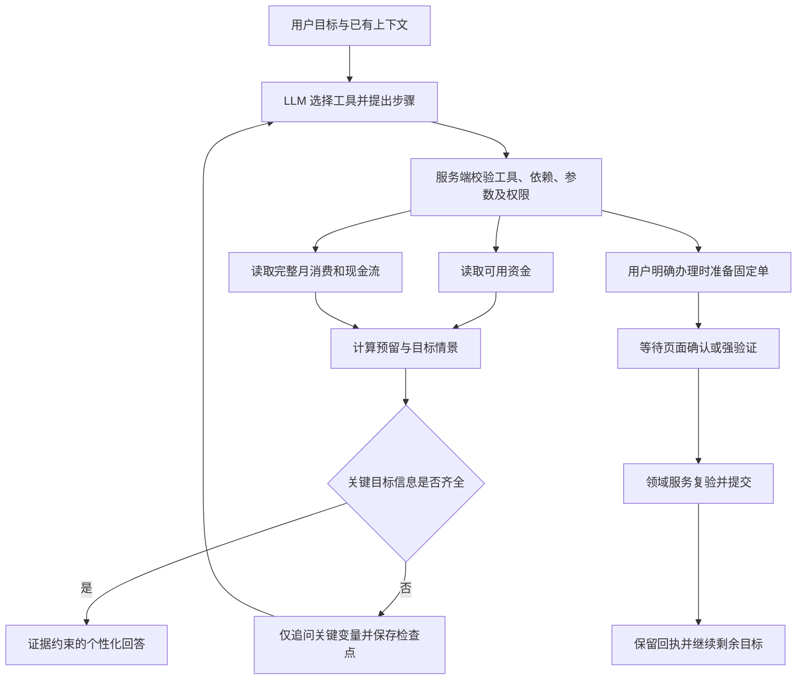

# FinAgent 赛题对照与后续完善开发建议

> 编制日期：2026-10-17。本文是基于当前代码、数据说明和已留存验收记录的开发建议，不代表本文所列待办已经实现。本轮仅编写文档，不修改代码、配置或业务数据库。

## 1. 最新成果在哪里

最新成果所在的大文件夹：

```text
D:\FinAgent-最新项目-20261014-7e16cd7(1)\FinAgent-最新项目-20261014-7e16cd7
```

实际应用根目录是其下的 `finagent`：

```text
D:\FinAgent-最新项目-20261014-7e16cd7(1)\FinAgent-最新项目-20261014-7e16cd7\finagent
├─ backend/                  后端、工具、领域服务、迁移及测试
├─ frontend/                 已移植并修复的当前前端
├─ datasets/demo_financial_v2/ 年度合成金融案例及校验清单
├─ docs/                     开发记录、验收说明及本文件
├─ scripts/                  启动、安装、测试与导入脚本
└─ var/
   ├─ finagent.sqlite3       当前应用数据库，包含用户后续操作
   ├─ reviews/               各轮验收证据
   └─ backups/               安装前备份
```

`D:\finagent` 是旧工作区及后续隔离开发、测试工作区；其中 `var` 有各轮副本和安装记录。`D:\finagent(1)` 是新前端的来源目录。继续开发、打包、演示时，应以以上最新项目根目录为准，不能只凭文件夹修改时间决定版本。

当前最近的两轮成果是“对话运行稳定性”和“P0 针对性财务分析”，证据分别在 `var/reviews/runtime-stability-20261017/`、`var/reviews/personalized-analysis-20261017/`。当前已安装迁移版本为 `0017_servicing`。旧文档中更早的工具数量、迁移版本和“尚待真实模型测试”等结论，应按时间与适用范围理解。

## 2. 当前阶段的判断

目前应优先把已有能力组织成可靠的完整任务，而不是继续以工具数量作为主要成果指标。

当前 Live 默认采用 **LLM 自主选择工具、根据工具结果继续决策** 的统一循环。模型可以不调用工具，也可以连续调用多个查询、计算或准备工具。服务端负责身份、参数、数据归属、证据和权限校验。敏感工具产生固定操作单并暂停，用户在对话页面确认或强验证后才能继续。

这符合此前讨论的 LLM + tools 方向，无须重新加入按旅游、理财、转账等意图分流的固定路由。未来的动态 DAG 应当增强目标、依赖、恢复和可观测性，不能把模型重新限制在几个预设场景模板中。

需要明确的现状边界：

- 当前目录有 **62 项可调用工具定义，包含兼容别名**，不等于 62 个独立银行业务。
- 当前有动态调用记录、历史规划器和任务检查点，但**尚不是通用的、可局部重规划的动态 DAG 调度系统**。节点存在 `depends_on` 不足以证明已完成这一能力。
- 六类赛题场景均有主要能力，但业务执行是本地金融模拟。真实银行接口、真实短信认证、真实商户取消及生产审批系统尚未接入。
- 资产负债档案较完整，不代表所有导入产品均可办理。导入基金等只读快照，不能自动作为本系统可赎回持仓。
- 大账本统计已使用服务端聚合，仍需专项验证更大规模、并发、长对话和复杂任务下的稳定性。

## 3. 赛题要求逐项对照

### 3.1 六类业务场景

| 赛题方向 | 当前可展示的能力 | 需要继续完善的重点 | 验收关键点 |
|---|---|---|---|
| 智能转账 | 按姓名、手机号、备注匹配；同名澄清；新收款人资料及付款账户补充；普通转账、一次预约、AA 收款 | 跨轮补充与插入查询的全面回归；复杂条件与周期能力声明；多步骤办理后的继续执行 | 不猜收款人、不继承已取消金额；账户表单可选；重复确认只产生一笔；AA 发起不等于收齐 |
| 账单分析 | 分类、商户、收入和现金流统计；月度/年度报告；异常线索；完整金融档案及历史 | 自然语言范围、覆盖缺口和口径表达；从统计到目标建议；多条件组合；可解释异常 | 聚合覆盖完整命中集；信用卡消费与还款不重复；缺口不记零；异常不等于盗刷 |
| 理财操作 | 模拟产品查询/比较、风险问卷、收益查询、模拟申购赎回；个性化财务底稿与计算 | 适当性与到期负债联动；目标优先级；更多语义评测；真实产品适配层 | 问卷由本人填写；建议不触发申购；导入快照不冒充可操作持仓；申购红色强验证 |
| 卡片管理 | 冻结/解冻、挂失/解挂、虚拟卡申请、单笔限额、线上限制；模拟借记卡补发；信用卡授信申请 | 生命周期一致性、补卡后的授权迁移说明、信用卡与借记卡差异、真实审批适配 | 解冻不解除挂失；补卡原卡永久停用；调额只是申请，独立审批后更新模拟覆盖层 |
| 订阅与代扣 | 黄色查询；疑似订阅识别、扣费证据、提醒；银行代扣解除；本地商户会员续订取消 | 更多合同类型适配；跨卡/周期展示；识别准确率；逐状态说明；操作后复查 | 查询授权不等于取消授权；停银行代扣不等于解会员合同；保留权益截止日；不自动退款 |
| 跨场景生日联动 | 生日预算预留、本地花束/蛋糕报价、授权安排、后台调度、修改/取消/重试 | 目标级 DAG、部分成功与补偿、时钟和授权失效、联动全过程展示 | 预留不是已付款；定时到期重新校验；已执行不删账；采购是本地模拟，不能冒充真实配送 |

新增工具前先判断：是缺少真正的业务能力，还是已有工具的参数、权限衔接、结果表达或恢复能力没有做好。后一类问题不能靠新增一个同义工具解决。

### 3.2 核心技术要求

| 要求 | 当前基础 | 后续工作与边界 |
|---|---|---|
| 绿色自动执行 | 本人余额、流水、账单等查询自动执行 | 查询工具仍需归属和数据版本校验；绿色不代表任意用户数据都能读取 |
| 黄色用户确认 | 对话内固定单、明确按钮确认；小额转账及订阅专项查询等 | 统一未授权、授权过期、改单失效、用户拒绝后的继续说明，避免直接拒绝后无出路 |
| 红色强验证 | 模拟短信挑战与固定单绑定，挂失/解挂、申购、大额转账等使用 | 生产身份认证和独立认证通道未接入；密码修改尚不是已交付业务，不能写进现有能力 |
| 幻觉防护 | 工具证据、金额单位校验、结构化财务回答、业务回执 | 继续覆盖因果与定性判断；有真实数字不代表结论一定成立 |
| 注入防御 | 工具白名单、类型校验、模型无确认/MFA/审批能力 | 加入恶意商户名、备注、知识内容及工具返回的注入评测；不能承诺所有注入绝对无效 |
| 操作审计 | 消息、步骤、授权、任务控制、领域事件和回执 | 统一端到端 trace、决策摘要及关联索引；不记录或展示模型私有思维链 |
| 异常熔断 | 认证失败持久锁定；相同失败调用有界重试 | 区分认证攻击、参数错误、网络错误、业务拒绝和模型预算耗尽，分别处置 |
| 沙箱 | 类型化工具/计划、受限参数校验进程、无任意 Shell 工具 | 当前不是任意生成代码的完整 OS 沙箱；容器候选配置仍需实跑。若无代码生成需求，继续保持受限计算 DSL |
| 模糊及上下文理解 | 动态工具循环、跨轮草稿与澄清、唯一上下文恢复 | 目标级状态、多个未完成意图隔离、代词与否定、条件保真、长对话摘要 |
| 复杂任务 DAG | 已有有序规划和动态调用轨迹 | 完善通用依赖图、运行时扩展、局部重规划、持久检查点和依赖驱动恢复 |
| 中断/回退/人工接管 | 暂停、恢复、取消、模拟坐席；已完成回执保留 | 明确回退仅能停止未执行项；真实资金撤回需要独立补偿业务和再次授权 |
| APP/IM 等渠道 | 当前 Web 对话与业务面板 | 增加渠道接入协议及移动端适配；当前不能宣称已接入微信、企业 IM 或语音 |

## 4. 后续开发优先级

以下 P0/P1/P2 是本项目的建议排序，不是赛事官方评分权重。建议每轮完成可验收的纵向任务，而不是同时重构所有模块。

| 编号 | 优先级 | 工作包 | 完成标志 |
|---|---|---|---|
| F01 | P0 | 财务分析的经济含义与情景质量 | 多画像同题得到有差异、证据充分且无口径冲突的建议；计算可复核 |
| G01 | P0 | 显式目标、依赖与持久执行图 | 可说明每个目标已完成/待输入/待确认/失败；恢复不重放已成功写入 |
| S01 | P0 | 确认、强验证及后台授权闭环回归 | 改单、换用户、并发、过期、暂停、拒绝和恢复都不能绕过权限 |
| D01 | P0 | 大数据与运行预算专项验收 | 有数据规模、正确性、延迟、调用次数、失败恢复的可复现实测报告 |
| E01 | P0 | 代表性多轮场景与答辩证据固化 | 绿色、黄色、红色和复杂任务有完整截图/回执/报告，版本一致 |
| O01 | P1 | 统一审计、可观测性与故障诊断 | 每个回答/操作能按任务定位工具、授权、回执、失败与恢复节点 |
| T01 | P1 | 工具契约与目录自动生成 | 代码、模型 schema、前端表单、工具清单版本一致，别名清楚 |
| B01 | P1 | 业务纵深及渠道适配 | 根据演示缺口补充周期规则、合同类型、到期债务/提醒和渠道入口 |
| P01 | P1 | 生产安全及外部接口预研 | 登录、真实 MFA、密钥管理、银行/商户适配接口设计并隔离模拟实现 |
| X01 | P2 | 更广场景及扩展部署 | 多目标优化、多币种、外部报价等在数据和安全条件满足后增加 |

## 5. F01：继续完善针对性财务分析

### 5.1 当前已经做过什么

最新一轮已增加：围绕目标的结构化结论、最多三条依据、最多两个情景、最多两个追问；事实引用和服务端来源推导；完整月份财务底稿；可用现金、快照资产、经营回款及净现金流的区分；`goal_budget`、`emergency_check`、`savings_capacity` 三种计算。

因此后续重点是提高判断质量及覆盖面，不是再写一遍“根据存款给建议”的提示词。

### 5.2 期望的分析过程

1. 先识别用户目标和决策：是否负担得起、能否稳定存钱、怎样减轻压力、是否应推迟大额支出等。
2. 查询与此有关的本人资产流动性、消费、收入波动、现金流、负债及数据覆盖；只查必要范围。
3. 区分已知事实、用户假设和系统演示假设。未知旅行成本不能填零；负债余额不能直接当成本月应付。
4. 用计算工具形成少量可比较情景，不让 LLM 心算金额。
5. 先给判断，再给两三条决定性依据，最后给行动建议及最多两个关键追问。
6. 用户只问建议时保持分析流程；只有明确提出办理才准备操作单。

例如“根据我的存款和消费，判断下个月能不能旅游”，更好的回答应当说明：可用资金与必要预留后的空间、历史结余是否稳定、信用卡/贷款是否存在近期压力，以及预算或天数中哪一项未知会改变判断。不能只复述全套资产清单，也不能虚构日本实时机票和酒店价格。

### 5.3 新一轮具体任务

| 任务 | 为什么需要 | 验收方式 |
|---|---|---|
| 将近期应付款与历史支出连接 | 避免漏掉到期大额付款，或重复扣除已包含的还款 | 已到期/未到期、已支付/未支付分别测试，明确“信息不足” |
| 将必要开支与可调整开支分开 | 分类大不等于浪费；经营成本不能都叫生活费 | 同一分类包含经营与生活的样例，拒绝无依据“削减 30%” |
| 多目标冲突与优先级 | 旅行、装修、还债、储蓄可能同时争夺现金 | 用户选择优先级前不替用户锁定资金；输出可比较情景 |
| 收入波动和压力情景 | 月均结余掩盖断收或不稳定收入 | 工资、自由职业、经营回款、退休收入分别评测 |
| 更明确的情景语义校验 | 引用正确金额仍可能解释相反 | 正余量不能说“必须挪用已保留应急金”；负缺口有明确金额和假设 |
| 未知信息的最小追问 | 不该重复询问工具已能查到的存款与支出 | 先查询；只问目标成本、计划期限、其他未记录义务等决策变量 |
| 跨轮用户假设撤销 | 用户改预算/期限后旧情景应失效 | “不是两万，是八千”“取消买车先还债”等不能继续用旧成本 |

### 5.4 建议评测集

至少覆盖：稳定工资、低现金、高资产低流动性、负净资产经营、收入中断、家庭与经营混合、信用卡跨月、退款、数据缺口、多卡多账户、多目标、外币未知、金额单位“万”、未来大额付款。

逐案例人工复核六项：目标理解、口径正确、事实来源、计算正确、结论与计算一致、追问与行动是否恰当。建议将确定性算术/权限项设为必须通过项；自然语言质量单独评分，不能用平均分抵消安全失败。评测目标应在跑测前锁定，本文不虚构当前成功率。

## 6. G01：动态 DAG 的完善方向

### 6.1 动态 DAG 应该解决什么

动态 DAG 是模型围绕当前问题建立、并可根据工具结果调整的任务依赖图。它不是为“旅游”“买房”“转账”各写一张定死的图。

以“存款够不够下个月旅游”为例，模型可能并行查询可用资金与完整月消费，随后计算预留和目标预算；若发现收入不稳定，再补充现金流分析；若目标成本未知，保留已完成证据并只追问预算。用户没有提出付款时，图中不应出现转账或申购节点。

对于简单的“你好”，图可以只有回答节点；对于单一余额查询，可以只有查询和回答。**不能为了展示 DAG 而强迫每个问题生成冗长计划。**



图中查询与办理是按需要出现的两类路径，不表示每次咨询都会附带办理。

### 6.2 先建立目标层，再建立执行层

建议将 `goal` 和 `node` 分开：

- 目标描述用户要得到的结果，如“知道可用于旅行的预算”“取消指定服务的下期续订”。
- 节点描述取得结果所需的一次动作，如“查询现金”“核对合同”“计算”“等待用户授权”。
- 工具失败只说明节点失败，不能直接把整个用户目标标记完成；旧业务成功也不能覆盖当前查询未完成。

建议的最小节点契约：

| 字段 | 用途 |
|---|---|
| `task_id / plan_version / node_id` | 标识任务、图版本和节点；阻止旧响应写回新图 |
| `goal_ids` | 说明该节点支持哪些用户目标 |
| `tool / arguments` | 只允许注册工具和类型化参数 |
| `depends_on / result_refs` | 明确先后依赖及引用结果，不使用模糊自然语言取值 |
| `effect` | 区分只读、计算、准备、等待人工、受信任提交；由注册表决定 |
| `preconditions` | 数据版本、资源状态、确认与验证条件 |
| `status` | planned、ready、running、waiting_input、waiting_confirmation、waiting_verification、succeeded、failed、blocked、cancelled、superseded 等 |
| `evidence_refs / receipt_ref` | 指向证据或实际业务回执，不能只保留模型总结 |
| `attempts / deadline / idempotency_key` | 约束重试、运行时限及重复提交 |

这是一份建议契约，不能当作当前 API 已有字段表。

### 6.3 LLM 与执行器的职责

**LLM 决定要查什么、如何拆解、何时追问和怎样解释。服务端决定哪些动作合法、依赖是否满足、授权是否有效以及是否可以提交。**

服务端不按业务关键词替 LLM 决定全部流程，但必须保留不可绕过的约束：

1. 图必须无环，引用已知节点与合法结果字段，不接受跨用户结果引用。
2. 金额、对象、时点和复杂条件须有本人明确表达或唯一有效上下文支持；未知条件不能被删除后继续。
3. 风险级别由工具和领域策略计算，模型声明 `green`、`authorized=true` 无效。
4. 模型没有确认、验证码、审批或任意提交工具。
5. 用户确认的是固定条款及版本；改单、资源变化或过期必须重新核对。
6. 权限拒绝不能通过模型改工具名、换调用顺序或局部重规划绕过。

### 6.4 运行时扩展与局部重规划

在工具返回后，模型可提出新增查询或替换尚未执行的节点。执行器应生成新计划版本并校验影响范围：

- 已成功的资金写入不可撤销或重放，保留原回执。
- 已完成且仍新鲜的只读证据可复用；账本或资源版本变化后，相关派生事实和计算须失效。
- 用户将预算从 18000 改为 8000 时，仅重算依赖预算的节点；不能再次扣款。
- 用户取消某个目标时，只停止该目标及其后续未执行节点；共享查询仍可支持其他有效目标。
- 用户插入“先查一下余额”时，暂存待办和草稿，查询后展示可继续的目标，避免把旧金额重新当作新指令。
- 外部接口超时且结果未知时先查状态，不能把超时直接理解为未执行并重试付款。

### 6.5 并行、事务与恢复

只并行执行互不依赖、相同权限范围内的绿色读取。需要一致统计口径时绑定读快照/数据版本，防止余额和支出来自不同状态。受保护的订阅读取即使只读，也须先获得黄色查询授权。

资金写入继续通过短事务和幂等约束串行保护，不在模型调用期间持有数据库写锁。不要把“图上可并行”直接等同于“多笔付款可以无序提交”。

持久化检查点应包含已完成节点、证据版本、待确认固定单、授权期限、失败分类和下一可运行节点。进程重启后先核对领域回执，再继续；浏览器断开不能丢失已确认结果。

“回退”须分别处理：未执行节点可取消；已预留但未支付的资金按业务规则释放；已支付只能走明确的退款/撤回/冲正等补偿能力，并重新校验和授权。当前没有这些真实银行补偿接口，不能宣称任意回滚。

### 6.6 建议拆成三个交付步

1. **目标台账与图契约**：先让现有动态工具循环产生可核对的目标/依赖记录，补状态与图校验，不急于并行。
2. **检查点与局部重规划**：解决输入、授权、执行后追问和重启恢复，完成不重放验证。
3. **受控并行与图展示**：只对已证明独立的读取开放并行；前端展示实际执行状态和待确认点，不能展示臆造的“已完成步骤”。

每一步均应保持现有单业务流程可用。以通用节点契约和工具元数据逐步替换旧状态衔接，避免一次重写所有领域服务。

## 7. S01：权限与安全闭环

### 7.1 不可变的权限原则

赛题要求的小额阈值是**本人跨账户、北京时间自然日累计、含本笔 ≤1000 元**；超过 1000 元红色。它与项目原有单笔和账户日硬限额不是同一个规则。临界值及两张黄色单同时确认必须专项测试。

订阅查询按赛题是黄色，不能因为“只读”而改为绿色。用户点击查询范围确认后，只得到相应查询权限，不能据此取消合同、解除代扣或授权后台扣款。

红色操作由用户在专用控件输入验证码，不能把验证码发给聊天模型。挂失/解挂、申购等固定红色能力，不因金额小或模型解释“安全”而降级。

### 7.2 必做回归矩阵

| 场景 | 必须观察到的结果 |
|---|---|
| 用户只说“确认” | 聊天文本不能替代页面固定单授权 |
| 查询后继续取消订阅 | 产生新的办理确认，不能沿用查询同意 |
| 旧单金额/账户被修改 | 旧凭据失效，出现新固定条款 |
| 先准备 600 元，再准备 500 元并相继确认 | 第二笔按实际累计重新分级，不能仍按旧黄色凭证执行 |
| 用户暂停后模型响应才回来 | 丢弃旧响应，不准备或执行新动作 |
| 已完成操作后模型断网 | 保留回执；恢复只解释或继续剩余目标，不再次付款 |
| 同一按钮重复点击、网络重发 | 返回同一回执，不重复记账 |
| 换用户、会话、数据版本或过期 | 受控拒绝并说明重新核对路径，不能复用授权 |
| 后台预约到期时余额/等级/授权变化 | 停止并提示重新办理，不能静默补强验证或挪用其他账户 |
| 连续认证失败 | 持久锁定，恢复后不自动重放失败操作 |

### 7.3 生产化与比赛演示分开

比赛阶段应将模拟 MFA、独立模拟审批、模拟商户边界写清，并完成以上闭环。若赛方要求真实 MFA，真实登录及短信/认证器接入应提升为提交前阻断项，不能用本地收件箱替代后声称已符合。

生产阶段需要账号认证、组织 RBAC、独立审批身份、密钥托管、令牌轮换、隐私分级、保留期和外部接口签名。密码修改、真实贷款还款、信用卡还款等尚未交付的写业务，应单独立项，不要直接暴露数据库修改作为模型工具。

## 8. D01：大量数据与稳定性

### 8.1 可确认的数据基线

年度合成样本为 2025-09-25 至 2026-09-24，共 365 天，20 人、56 账户、52 张卡、25,471 笔现金流水、903 笔负债事件、48 份订阅、514 次扣费尝试、23 张 CSV。首尾自然月不完整，且存在设计的数据缺口。

这些数字来自源数据清单，不是当前运行库永远不变的实时行数。运行库已有用户操作时可能更多。生成阶段 `manifest.json` 中的 `not_imported_into_live_database` 是生成时标记，不能覆盖后续导入说明与安装验证结果。

这属于有一定规模的演示账本，不足以证明已具备银行生产级海量并发能力。

### 8.2 应坚持的数据处理方式

- 筛选、排序、聚合和统计在服务端完成；模型只接收有界摘要、必要证据及分页入口。
- 逐笔列表是明细查看，不是从第一页推断全年总额的依据。
- 事实包含统计范围、币种、单位、账本来源、覆盖情况、截至日和版本。
- 现金流、消费、还本、本人转账、退款分别核算；基金市值、授信额度和保险保额不冒充现金。
- 历史快照、当前余额和未来计划明确区分；未来扣款不能说成已经支出。
- 相同成功查询可复用证据，但不能跨用户、跨期间、跨数据版本复用。

### 8.3 需要实测而不能口头承诺的指标

| 测试维度 | 建议样本 | 应记录的内容 |
|---|---|---|
| 统计正确性 | 月、年、半年分类；多卡；退款；内部调拨；覆盖缺口 | 与独立账本核算逐项比对，金额到分，记录不一致原因 |
| 数据量扩展 | 原始规模、约 10 倍、约 100 倍的隔离生成账本 | 查询计划、索引命中、聚合延迟、内存、数据库体积；这些是计划规模，尚非现有实测 |
| 复杂对话 | 20 轮以上插入、改目标、取消、恢复 | 上下文大小、事实丢失、旧金额串用、错误重试次数 |
| 并发 | 分别测试多用户只读、同用户写入竞争、后台调度竞争 | p50/p95、错误率、锁等待、重复记账数、权限重新分级 |
| 模型资源 | 单查、组合分析、财务情景、复杂办理 | 模型轮数、工具次数、token、总耗时、修正次数和失败分类 |
| 故障 | 模型超时、网络断开、后端重启、重复请求 | 成功回执保留、结果未知恢复、检查点一致性与无重复写入 |
| UI 承载 | 长列表、窄屏、长回复、多个固定单 | 分页、截断提示、滚动、用户消息即时显示、按钮禁用与状态一致性 |

不要预设一个“极低耗时”再倒推数据。先固定机器、版本、模式、数据量和并发条件，跑出基线，再制定优化目标。语义正确、安全与性能分开报告。

### 8.4 调用预算耗尽的体验

现有运行时已限制模型/工具调用及重复失败。后续应让剩余预算影响规划：证据足够时停止补查；同参数失败不循环；预算将尽时给出已完成结论、缺少信息及继续入口。预算耗尽不能抹去已完成业务，也不能静默切 Mock。

对于长对话，保存结构化目标、用户明确约束、有效证据索引和待确认单；摘要不得把“可能”“不需要”“暂不办理”改成已同意。

## 9. O01/T01：工具契约、审计与工程一致性

### 9.1 工具不是只有名称和说明

建议统一登记：输入/输出 schema、本人归属规则、风险判定器、前置权限、可产生的副作用、幂等键、证据格式、错误分类、恢复策略及前端展示组件。

业务执行只能通过受信任领域服务；不要为方便模型加入“任意改账户”“execute_sql”“确认所有操作”工具。新增能力应带至少一条正常链路与一条关键越权/重复提交回归。

### 9.2 自动生成目录

现有静态 `完整工具定义-20261017.json` 等文档早于最新计算/回答 schema 的修改，不应直接充当最终接口规范。建议从当前注册表、`dynamic_protocol.py` 和实际模型 schema 自动生成目录、别名映射、前端必填项和版本摘要；在 CI 中检查差异。

还需检查业务规则说明与新增能力的一致性。例如当前 `backend/app/domain/card_management.py` 的 `RULES` 仍包含“当前不提供补卡”，而补卡已由 `servicing.py` 实现。这类旧说明应列入后续修订，避免模型或页面读取旧规则后与现有工具相矛盾；本轮文档编写不修改该代码。

不必把所有 alias 都展示给模型或评委。模型目录要控制重叠说明，防止多个同义工具增加选择困难；兼容层可以保留。

### 9.3 可核对的审计链

建议统一关联：用户请求 → 目标/图版本 → 工具参数摘要 → 证据 → 风险分级 → 固定单摘要 → 人工确认/强验证 → 领域提交 → 回执 → 回复。

审计应记录可复核的决策依据和系统事件，不要求保存模型私有思维链。默认脱敏账号、验证码、密钥及不必要的原始金融档案；查看审计也要鉴权。错误日志不能把敏感输入原样返回模型或页面。

## 10. 建议的下一轮实施顺序

### 第一轮：先保证现有主链可验收

1. 固定代码、数据与策略版本，建立隔离演示库，不重置正式库。
2. 完成财务分析多画像评测和经济含义检查。
3. 跑通付款账户补充、订阅双确认、红色验证、改单失效、断网保回执。
4. 留存原始测试报告、真实 DeepSeek 对话和演示截图。

交付：稳定场景清单、失败分类、修复记录和可复现验收报告。此阶段不要求完成整个通用 DAG。

### 第二轮：目标层与动态 DAG 最小闭环

1. 建立目标台账和类型化图契约。
2. 接入已有工具循环，记录真实依赖，不改领域提交权限。
3. 实现输入等待、授权等待、重启恢复和一次局部重规划。
4. 用“分析 → 用户改变预算 → 补查 → 准备操作 → 用户确认 → 继续查询”验收，不重放已成功步骤。

交付：可持久执行图、版本失效规则、恢复测试和实际状态展示。

### 第三轮：规模、工程与业务纵深

补齐大数据/并发基线、统一 trace、目录生成和渠道协议；再按赛题与演示价值决定真实认证、更多合同类型或新的业务工具。是否接入真实银行/商户，应与参赛范围、接入条件和认证要求一起决定。

## 11. 当前证据与使用规则

优先阅读：

- [P0 针对性财务分析开发记录](开发记录-P0针对性财务分析-20261017.md)
- [对话运行稳定性开发记录](开发记录-对话运行稳定性-20261017.md)
- [工具与底层业务补全](工具与底层业务补全-20261017.md)
- [对话内统一授权实现与验证](对话内统一授权实现与验证-20261016.md)
- [转账表单与即时消息修复](转账表单与即时消息修复-20261016.md)
- [权限与安全设计](P0-安全与权限设计.md)
- [年度案例数据导入说明](年度案例数据导入说明.md)
- [数据集 README](../datasets/demo_financial_v2/README.md)

最新财务分析验收目录 `var/reviews/personalized-analysis-20261017/` 包含：

- `backend-tests-final.xml`：广泛后端回归，444 项测试及 4 个子测试；JUnit 记录数为 448。
- `targeted-final.xml`：最终定向回归 114 项，与前项有重叠，不能相加宣传。
- `live-verified.json`：七类真实 DeepSeek 合成案例，不等于所有银行业务端到端均已覆盖。
- `verification-summary.json`：结构化输出、调用次数及业务表保持等统计。
- `installed-smoke.json`：已安装版本的模式、数据集、迁移及页面/健康检查；此安装冒烟没有额外调用模型。

上述记录来自既有开发轮次，本次文档编写没有重新执行全量测试。后续改动后应重新验收，不能沿用旧报告证明新实现。

## 12. 下一轮完成定义

下一轮若重点做 P0，建议以以下条件共同作为结束标准：

- 用户能得到针对本人财务和目标的可复核判断，而不是通用知识拼接。
- 每个目标有明确状态，未完成项、缺少条件及下一步可见。
- 敏感工具自然进入对话内确认/强验证，授权不能被模型获得或绕过。
- 修改、拒绝、中断、网络故障及恢复不重复执行业务。
- 完整账本聚合与边界口径正确，有实际资源与性能基线。
- 答辩材料中的每一项“已实现”都有对应代码、验收或真实截图；规划与模拟边界明确。

实际材料制作顺序、18 页主稿建议、代表性提问及截图取证方法见 [答辩 PPT 制作指南与截图脚本](答辩PPT制作指南与截图脚本-20261017.md)。
